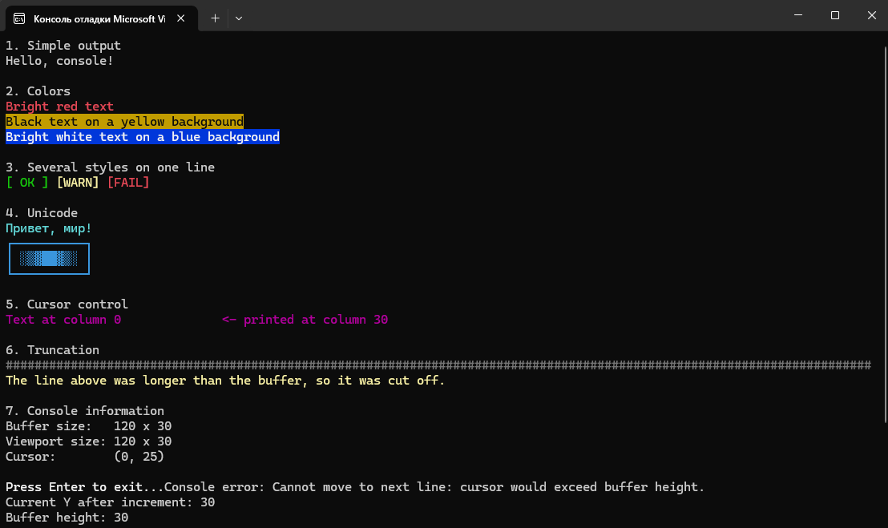
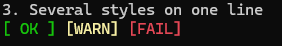
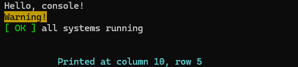

# console

A small, dependency-free C++ library for styled output in the Windows console.

It wraps a handful of WinAPI console functions (`WriteConsoleOutputW`, `SetConsoleCursorPosition`, `SetConsoleWindowInfo`, ...) behind a simple, documented interface: print UTF-8 strings in 16 foreground and 16 background colors, move the cursor, and read or change the viewport and buffer size. Errors are reported as standard C++ exceptions with descriptive messages.

> **Status:** complete. This was a learning project, and no further development is planned.

---

## Screenshots

> 

> 

---

## Features

- Colored text and background (16 colors each) via `text_color` and `bg_color` enums
- UTF-8 input, converted to UTF-16 internally (Cyrillic, box-drawing and block characters work)
- `printStyle` (no line break) and `printStyleLine` (with line break)
- Predictable truncation at the right edge of the buffer instead of silent corruption
- Cursor control: set and get the position, move to the next line
- Viewport and buffer control: set and get position and size
- Errors reported through standard exceptions with detailed messages
- Doxygen-style documentation in the header

## Requirements

- Windows
- A C++ compiler with C++14 or newer (tested with MSVC)
- Output must go to a real console window (not redirected to a file or pipe)

## Getting started

1. Copy `console.h`, `console.cpp` and `color.h` into your project.
2. Add `console.cpp` to your build.
3. Compile with UTF-8 source encoding enabled.

**MSVC command line:**

```
cl /EHsc /std:c++17 /utf-8 basic_example.cpp console.cpp
```

**Visual Studio:** Project Properties -> C/C++ -> Command Line -> Additional Options -> add `/utf-8`.

> The `/utf-8` flag matters. Without it, string literals with non-ASCII characters (for example Cyrillic) are stored in the system code page, and the library, which expects UTF-8, will print garbage.

## Quick example

```cpp
#include "console.h"

int main() {
    // White on black by default
    console::printStyleLine("Hello, console!");

    // Text color, then background color
    console::printStyleLine("Warning!", text_color::Black, bg_color::Yellow);

    // Several styles on one line: printStyle does not break the line
    console::printStyle("[ OK ]", text_color::BrightGreen);
    console::printStyle(" all systems running");
    console::moveToNextLine(true);

    // Cursor control
    console::setCursorPosition(10, 5);
    console::printStyle("Printed at column 10, row 5", text_color::BrightCyan);
}
```

A longer, commented walkthrough is in [`basic_example.cpp`](basic_example.cpp).

> 

## API overview

| Function | Description |
|---|---|
| `printStyle(line, text_color, bg_color)` | Prints a UTF-8 string at the cursor. The cursor stays right after the text. |
| `printStyleLine(line, text_color, bg_color, line_begin)` | Same as `printStyle`, then moves to the next line. |
| `setCursorPosition(x, y)` | Moves the cursor to an absolute buffer position (zero-based). |
| `getCursorPosition()` | Returns the current cursor position. |
| `moveToNextLine(line_begin)` | Moves the cursor one row down, optionally to column 0. |
| `getBufferSize()` / `setBufferSize(w, h)` | Reads or changes the screen buffer size. |
| `getViewportSize()` / `setViewportSize(w, h)` | Reads or changes the size of the visible window area. |
| `getViewportPosition()` / `setViewportPosition(x, y)` | Reads or changes the top-left corner of the visible area (scrolling). |
| `setViewportRECT(rect)` | Sets the position and size of the viewport at once. |

All functions live in the `console` namespace. Full parameter and exception descriptions are in `console.h`.

### Colors

`text_color` and `bg_color` provide the same 16 values: `Black`, `Blue`, `Green`, `Cyan`, `Red`, `Magenta`, `Yellow`, `White` and their `Bright*` variants.

## Behavior notes

- **Truncation.** If a string does not fit between the cursor and the right edge of the buffer, the part that does not fit is discarded. There is no automatic wrapping, and the buffer is never resized implicitly. After a truncated print the cursor is on the last column of the buffer.
- **Cursor after printing.** After `printStyle`, the cursor is placed right after the last printed character, but never beyond the last column.
- **Last buffer row.** `printStyleLine` may throw `std::out_of_range` when the cursor is already on the last row of the buffer. The text is printed before the exception is thrown.
- **Minimum size.** The viewport and the buffer cannot be set narrower than 50 columns.
- **Coordinates** are absolute positions in the console buffer, not in the visible window.

## Limitations

- Windows only (uses the WinAPI console functions).
- Only single-width characters from the Basic Multilingual Plane are supported. Emoji (surrogate pairs) and wide characters such as CJK are not handled correctly.
- Control characters such as `\n` are not interpreted. Use `moveToNextLine` or `printStyleLine`.
- Only the 16 standard console colors are available (no RGB).
- Not thread-safe: the library keeps a shared internal cache of the console state.
- Does not work when standard output is redirected to a file or pipe. In that case functions throw `std::runtime_error`.

## Possible future work

These ideas are not planned, but they would be natural next steps:

- A custom string type that carries several styled segments
- A cross-platform backend based on ANSI escape sequences
- Full Unicode support (surrogate pairs, double-width characters)
- Thread-safe state handling

## License

Released under the [MIT License](LICENSE).
